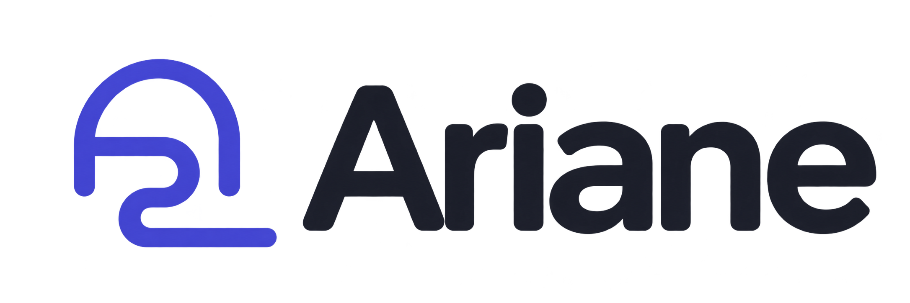

<p align="center">
  
</p>

<h1 align="center">Clear the backlog. Keep the expertise.</h1>

<p align="center">
  Ariane prepares repetitive immunological review work to restore team capacity,<br>
  without automating the biologist's decision.
</p>

<p align="center">
  <strong>🏆 Best Patient Solution Award</strong><br>
  AI for Health Hackathon · Paris · November 13–15, 2026
</p>

<p align="center">
  <a href="#why-ariane">Why Ariane</a> ·
  <a href="#demo">Demo</a> ·
  <a href="#local-setup">Local setup</a> ·
  <a href="docs/PILOT.md">Pilot approach</a> ·
  <a href="docs/RESPONSIBLE_USE.md">Responsible use</a>
</p>


## Why Ariane

Immunological review in transplantation requires professionals to reconstruct histories, compare successive results, and identify records that need deeper review. When this repetitive preparation consumes expert time, the backlog grows faster than the team can clear it.

**Ariane turns this accumulation into a clear, prioritized work queue.** The product brings together a synthetic record history, exposes missing or uncertain information, and separates two workflows:

- **Ready to sign**: the record is prepared for a final professional check;
- **Needs review**: the record remains visible for deeper review.

The biologist retains the decision and explicitly initiates every validation.

## Value proposition

| Operational problem | Ariane's response | Intended value |
| --- | --- | --- |
| History must be reconstructed record by record. | Results and events are combined into a longitudinal view. | Reduce time spent recovering context. |
| Routine and complex cases share the same queue. | Two workflows make records requiring deeper review immediately visible. | Focus expert time where it is most useful. |
| Missing information can be difficult to identify. | Missing data and limitations remain explicit. | Prevent missing information from becoming a favorable conclusion. |
| The backlog keeps growing. | Preparation and prioritization aim to restore team capacity. | Move an estimated six-month backlog toward one month, subject to pilot confirmation. |

The **6 → 1 month** target is an operational ambition based on the field need. It is not an achieved result and must be measured with a pilot team before being communicated as performance.

## What we built in 50 hours

- a public landing page consistent with the Ariane identity;
- a dashboard with search, filters, sorting, and pagination;
- a synthetic patient file with history and serum evolution;
- **Ready to sign** and **Needs review** queues;
- a signature triggered only by an explicit human action;
- a FastAPI API, local PostgreSQL database, and deterministic pipeline;
- frontend/backend contracts validated at system boundaries;
- automated tests for the pipeline, API, and web workflows.

The award recognizes the relevance of the proposal presented to the jury. It does not constitute clinical validation of the product.

## Synthetic scenario result

The scenario presented to the jury contains **1,000 entirely synthetic profiles**:

| Workflow | Profiles | Role in the demonstration |
| --- | ---: | --- |
| Prepared for validation | 714 | A professional checks every record before signing. |
| Kept for deeper review | 286 | The record remains visible in the review queue. |

These figures describe the demonstrator's controlled distribution. They do not measure clinical performance, time savings, or real-world prevalence.

## Demo

The presentation and product share the same frontend:

- `/` — storytelling, award, target impact, architecture, and safeguards;
- `/login` — entry point to the local demonstrator;
- [`demo-ariane.mp4`](web/frontend/public/showcase/demo-ariane.mp4) — short product walkthrough.

After starting the project locally, open <http://localhost:5173>.

## From product proof to impact proof

| Already demonstrated | To measure in a pilot |
| --- | --- |
| A complete, local, reproducible workflow | Preparation and review time |
| An interface tested with synthetic data | Changes in backlog size and age |
| Explicit human validation | Rework and corrections before validation |
| A proposal recognized for patient value | Professional adoption and understanding |

The [pilot approach](docs/PILOT.md) describes the indicators, scoping steps, and conditions required before any evaluation. A future professional version could add versioned protocols, stronger audit capabilities, access management, and deployment adapted to the target environment.

## Architecture

```text
Synthetic data
      │
      ▼
Deterministic pipeline ──► FastAPI ──► PostgreSQL
                               │
                               ▼
                        Next.js / React
                               │
                               ▼
                        Human validation
```

| Layer | Technologies |
| --- | --- |
| Presentation and application | Next.js 16, React 19, TypeScript, Tailwind CSS, shadcn/ui |
| Frontend state and validation | TanStack Query, Zod, React Hook Form |
| API | FastAPI, Pydantic, SQLAlchemy |
| Data | PostgreSQL, deterministic Python pipeline |
| Verification | Pytest, unittest, Playwright, axe-core |

The backend remains the source of truth for data and rules. The frontend validates received responses and presents them without recomputing medical interpretation.

## Local setup

### Requirements

- Node.js 22 or newer;
- Python 3.12 and [`uv`](https://docs.astral.sh/uv/);
- Docker with Compose.

### 1. Start PostgreSQL

```bash
docker compose -f dependencies/compose.yml up -d
```

### 2. Start the API and load the scenario

```bash
cd web
cp .env.example .env
cd backend
uv sync
uv run python -m app.seed
uv run uvicorn app.main:app --reload --host 0.0.0.0 --port 8000
```

### 3. Start the frontend

```bash
cd web/frontend
cp .env.example .env
npm ci
npm run dev
```

| Service | Local URL |
| --- | --- |
| Landing page and demonstrator | <http://localhost:5173> |
| API | <http://localhost:8000> |
| OpenAPI | <http://localhost:8000/docs> |

The guided scenario and fallback plan are documented in [`docs/DEMO.md`](docs/DEMO.md).

## Verification

```bash
# Frontend
cd web/frontend
npm run lint
npm run typecheck
npm run test:ui
npm run build

# Backend
cd ../backend
uv run pytest

# Data pipeline
cd ../../data-model
PYTHONPATH=src python3 -m unittest discover -s tests -v
PYTHONPATH=src python3 -m hla_data_model.validator data/scenarios
```

## Responsible use

Ariane is a hackathon demonstrator, not a clinically validated medical device.

- exclusively synthetic data in this repository;
- no autonomous transplant decision;
- no rejection prediction or treatment recommendation;
- no official LymFIP integration;
- uncertainty and missing information remain visible;
- final validation is explicitly human.

Read [`docs/RESPONSIBLE_USE.md`](docs/RESPONSIBLE_USE.md) before presenting or reusing the demonstrator.

## Documentation

| Document | Contents |
| --- | --- |
| [`docs/PRODUCT.md`](docs/PRODUCT.md) | Problem, value proposition, and product scope |
| [`docs/PILOT.md`](docs/PILOT.md) | Transition from demonstrator to supervised evaluation |
| [`docs/ARCHITECTURE.md`](docs/ARCHITECTURE.md) | Components, flows, and responsibilities |
| [`docs/DATA_PIPELINE.md`](docs/DATA_PIPELINE.md) | Synthetic data and reproducibility |
| [`docs/DEPLOYMENT.md`](docs/DEPLOYMENT.md) | Vercel Services and Neon deployment |
| [`docs/DEMO.md`](docs/DEMO.md) | Startup, walkthrough, and fallback plan |
| [`docs/HACKATHON.md`](docs/HACKATHON.md) | Context, 50-hour build, and award |
| [`docs/RESPONSIBLE_USE.md`](docs/RESPONSIBLE_USE.md) | Medical boundaries and responsible communication |
| [`BRAND.md`](BRAND.md) | Use of the Ariane name, logos, and media |
| [`CONTRIBUTING.md`](CONTRIBUTING.md) | Feedback, collaboration, and prohibited data |
| [`SECURITY.md`](SECURITY.md) | Private reporting and information that must never be published |

## License and rights

This repository is visible for presentation and evaluation purposes, but **it is not open source**. No right to use, modify, distribute, deploy, or commercially exploit the project is granted without prior written permission.

Commercial, research, or evaluation rights may be granted separately under a written agreement. See [`LICENSE`](LICENSE), [`BRAND.md`](BRAND.md), and [`CONTRIBUTING.md`](CONTRIBUTING.md).
