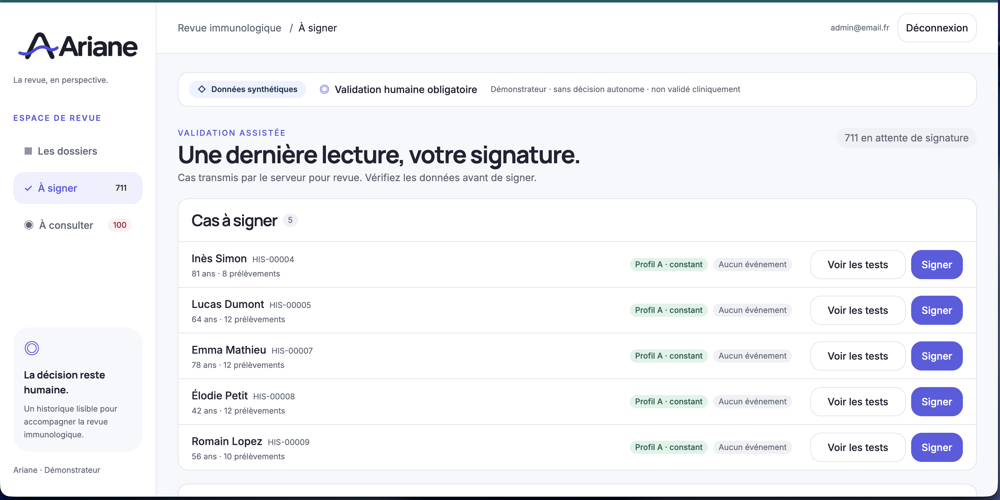

<p align="center">
  
</p>

<p align="center"><strong>Rendre du temps à l’expertise biologique.</strong></p>

<p align="center">
  <strong>🏆 Prix de la meilleure solution pour les patients</strong><br>
  AI for Health · Paris · 13–15 novembre 2026
</p>

<p align="center">
  <a href="#démonstration">Démonstration</a> ·
  <a href="#démarrage-local">Démarrage local</a> ·
  <a href="docs/ARCHITECTURE.md">Architecture</a> ·
  <a href="docs/RESPONSIBLE_USE.md">Usage responsable</a>
</p>



## Le projet

La revue immunologique en transplantation demande de reconstituer un historique, de confronter des résultats successifs et d’identifier les dossiers qui nécessitent une attention particulière. Cette charge répétitive réduit le temps disponible pour les situations complexes.

**Ariane prépare cette revue sans prendre la décision.** Le démonstrateur organise des données synthétiques, présente leur évolution dans le temps, sépare les dossiers proposés à la signature de ceux à consulter en détail et conserve une validation humaine explicite.

En 50 heures, le projet est passé d’un besoin terrain à un parcours fonctionnel réunissant une interface complète, une API, une base locale, un pipeline de données déterministe et des tests automatisés.

## Ce que montre Ariane

- import et analyse simulés de dossiers synthétiques ;
- cockpit de dossiers avec recherche, filtres, tri et pagination ;
- fiche patient avec historique et évolution sérique ;
- file **À signer** pour les dossiers préparés à la validation ;
- file **À consulter** pour les suivis nécessitant une lecture approfondie ;
- signature déclenchée uniquement par une action humaine ;
- fonctionnement local avec un backend et une base PostgreSQL.

## Résultat présenté au jury

Sur le scénario de démonstration composé de **1 000 profils synthétiques** :

| Parcours | Profils | Rôle dans la démonstration |
| --- | ---: | --- |
| Préparés pour validation | 714 | Le professionnel vérifie avant de signer. |
| Conservés pour revue approfondie | 286 | Le dossier reste visible dans la file de consultation. |

Ces nombres décrivent le jeu de démonstration. Ils ne constituent ni une performance clinique ni une estimation de résultats sur des patients réels.

## Démonstration

La landing page et la démonstration sont intégrées au frontend :

- `/` : présentation du projet, du prix, de l’architecture et des garde-fous ;
- `/login` : accès au démonstrateur ;
- vidéo : [`demo-ariane.mp4`](web/frontend/public/showcase/demo-ariane.mp4).

Après le démarrage local, ouvrir <http://localhost:5173>.

## Architecture

```text
Données synthétiques
        │
        ▼
Pipeline déterministe ──► FastAPI ──► PostgreSQL
                              │
                              ▼
                       Next.js / React
                              │
                              ▼
                       Validation humaine
```

| Couche | Technologies |
| --- | --- |
| Présentation et application | Next.js 16, React 19, TypeScript, Tailwind CSS |
| État et validation frontend | TanStack Query, Zod, React Hook Form |
| API | FastAPI, Pydantic, SQLAlchemy |
| Données | PostgreSQL, pipeline Python déterministe |
| Vérification | Pytest, unittest, Playwright, axe-core |

Le backend reste la source de vérité des données et des règles. Le frontend valide les réponses reçues et les présente sans recalculer une interprétation médicale.

## Démarrage local

### Prérequis

- Node.js 22 ou plus récent ;
- Python 3.12 et [`uv`](https://docs.astral.sh/uv/) ;
- Docker avec Compose.

### 1. Base PostgreSQL

```bash
docker compose -f dependencies/compose.yml up -d
```

### 2. Backend et données synthétiques

```bash
cd web
cp .env.example .env
cd backend
uv sync
uv run python -m app.seed
uv run uvicorn app.main:app --reload --host 0.0.0.0 --port 8000
```

### 3. Frontend

```bash
cd web/frontend
cp .env.example .env
npm ci
npm run dev
```

Le frontend est disponible sur <http://localhost:5173> et l’API sur <http://localhost:8000>.

Le scénario complet est détaillé dans [`docs/DEMO.md`](docs/DEMO.md).

## Vérifications

```bash
# Frontend
cd web/frontend
npm run lint
npm run typecheck
npm run test:ui
npm run build

# Backend
cd ../backend
uv run pytest

# Pipeline de données
cd ../../data-model
PYTHONPATH=src python3 -m unittest discover -s tests -v
PYTHONPATH=src python3 -m hla_data_model.validator data/scenarios
```

## Limites assumées

- données exclusivement synthétiques ;
- aucune validation clinique du démonstrateur ;
- aucune décision autonome de transplantation ;
- aucune prédiction de rejet ou recommandation thérapeutique ;
- aucune intégration officielle à LymFIP ;
- résultats finaux soumis à une validation humaine.

Lire [`docs/RESPONSIBLE_USE.md`](docs/RESPONSIBLE_USE.md) avant de réutiliser le démonstrateur dans une présentation.

## Documentation

- [`docs/PRODUCT.md`](docs/PRODUCT.md) — problème, proposition de valeur et parcours ;
- [`docs/ARCHITECTURE.md`](docs/ARCHITECTURE.md) — composants, flux et responsabilités ;
- [`docs/DATA_PIPELINE.md`](docs/DATA_PIPELINE.md) — données synthétiques et reproductibilité ;
- [`docs/DEMO.md`](docs/DEMO.md) — lancement et scénario de démonstration ;
- [`docs/HACKATHON.md`](docs/HACKATHON.md) — contexte, réalisation et prix ;
- [`docs/RESPONSIBLE_USE.md`](docs/RESPONSIBLE_USE.md) — limites médicales et communication responsable.

## Licence

Ce projet est publié à des fins de présentation et d’évaluation. **Il n’est pas open source.** Le code, la marque et les médias sont protégés par la licence propriétaire du dépôt. Toute utilisation, reproduction, distribution ou exploitation commerciale nécessite une autorisation écrite préalable. Voir [`LICENSE`](LICENSE) et [`BRAND.md`](BRAND.md).
